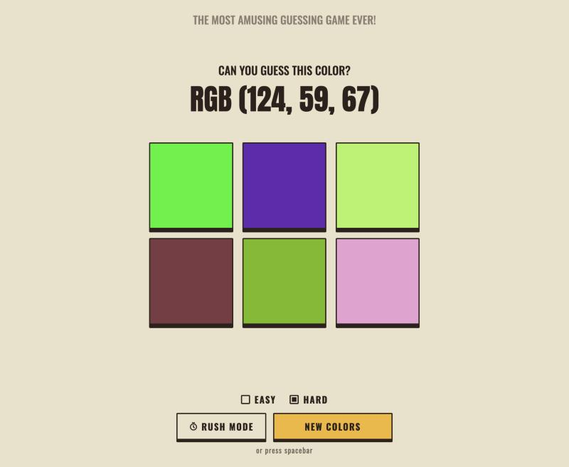
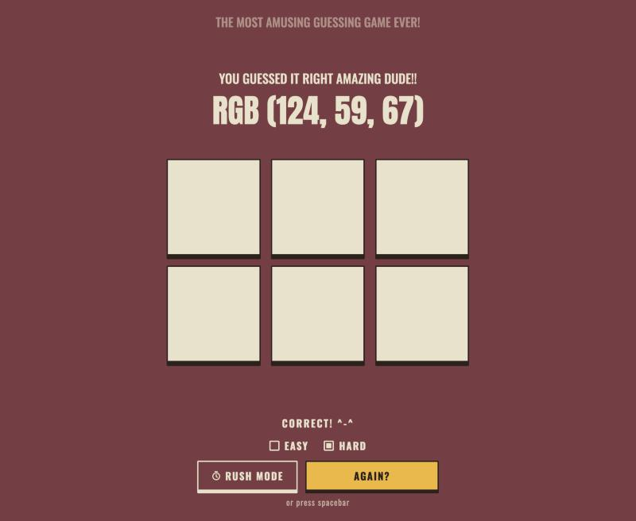
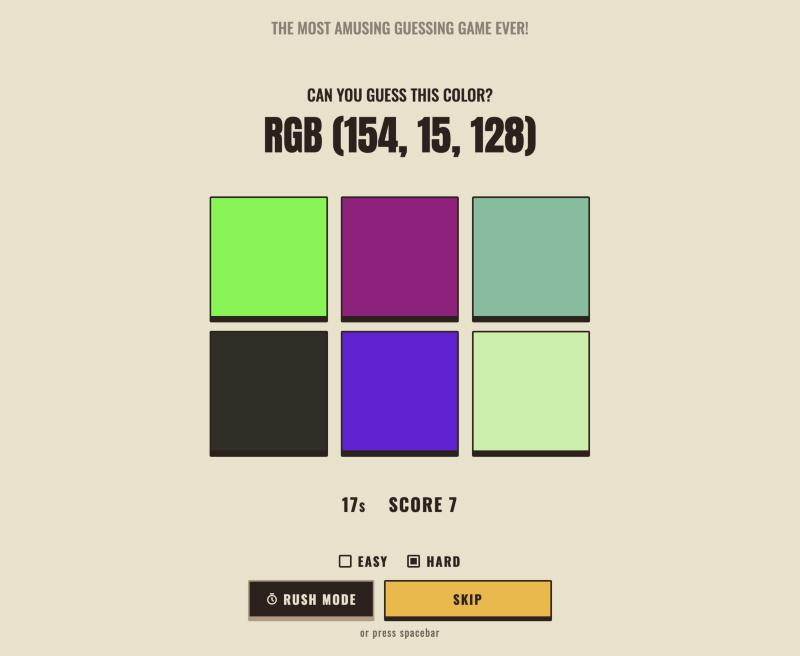

# Guess RGB Right

A game to get your right brain to work! You're shown an RGB value, can you pick the matching color?

**Play it online: https://roshnidesigns.github.io/guess-rgb-right/**

## How to play

- Look at the RGB value and click the box you think matches it.
- A wrong guess fades that box out, so try again.
- Guess right and the whole page turns that color.
- Pick **Easy** (3 colors) or **Hard** (6 colors).
- Hit **New Colors** or press the **spacebar** for a new round.

## Rush mode

How many colors can you get right in 30 seconds?

- Switch on **Rush Mode** and hit **Start** (or press the spacebar).
- Every correct guess scores a point and deals new colors right away.
- Wrong guesses cost nothing but time. Stuck? Hit **Skip**.
- Your best score is kept for the current browser tab, separately for Easy and Hard.

## Run it locally

No setup needed, just open `index.html` in your browser.

## Files

| File | What it does |
|---|---|
| `index.html` | Page layout: title, color boxes and controls |
| `colorguess.css` | Retro beige look, layout for phone and desktop |
| `colorguess.js` | Game logic for normal play and Rush mode |
| `images/` | Screenshots used in this README |

To change the Rush mode length, edit `RUSH_SECONDS` at the top of `colorguess.js`. The theme colors live at the top of `colorguess.css`.
